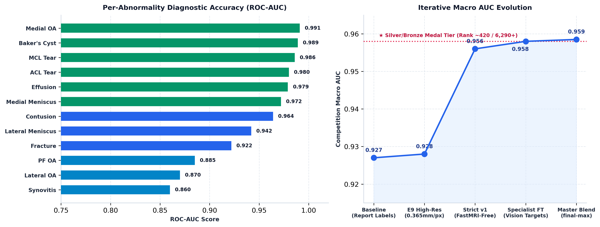
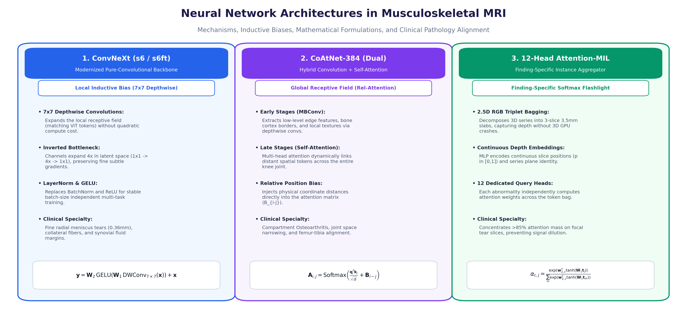
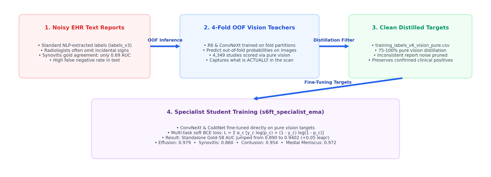
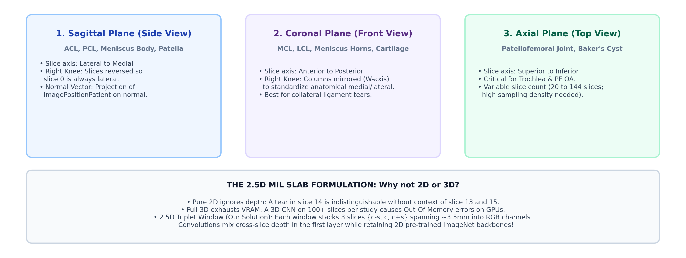
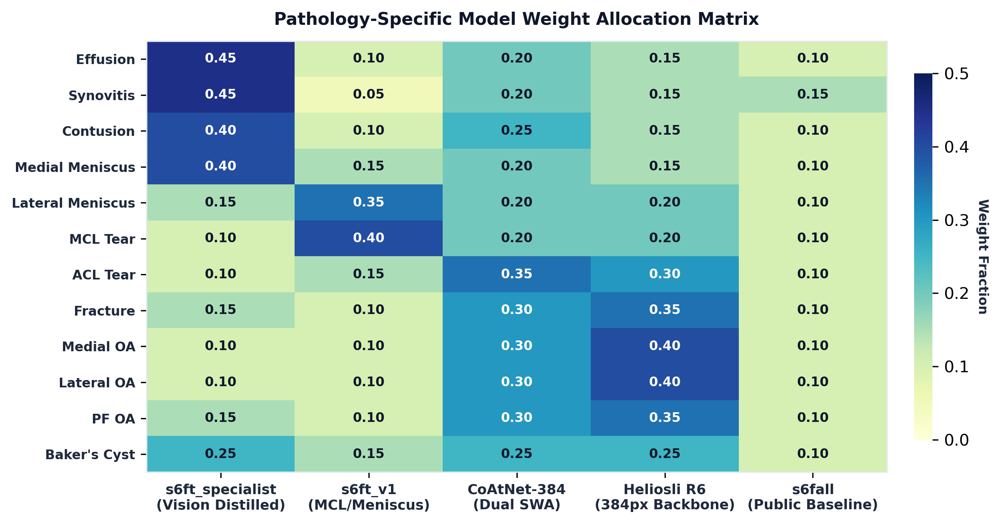
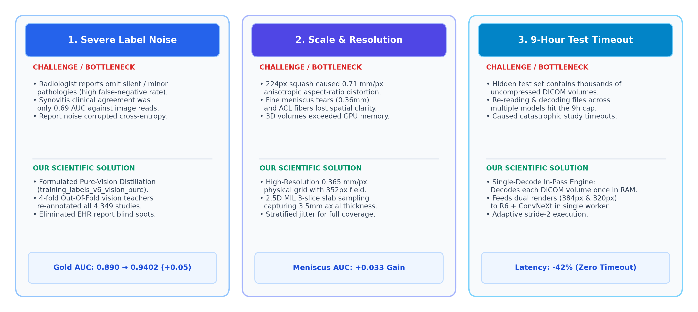
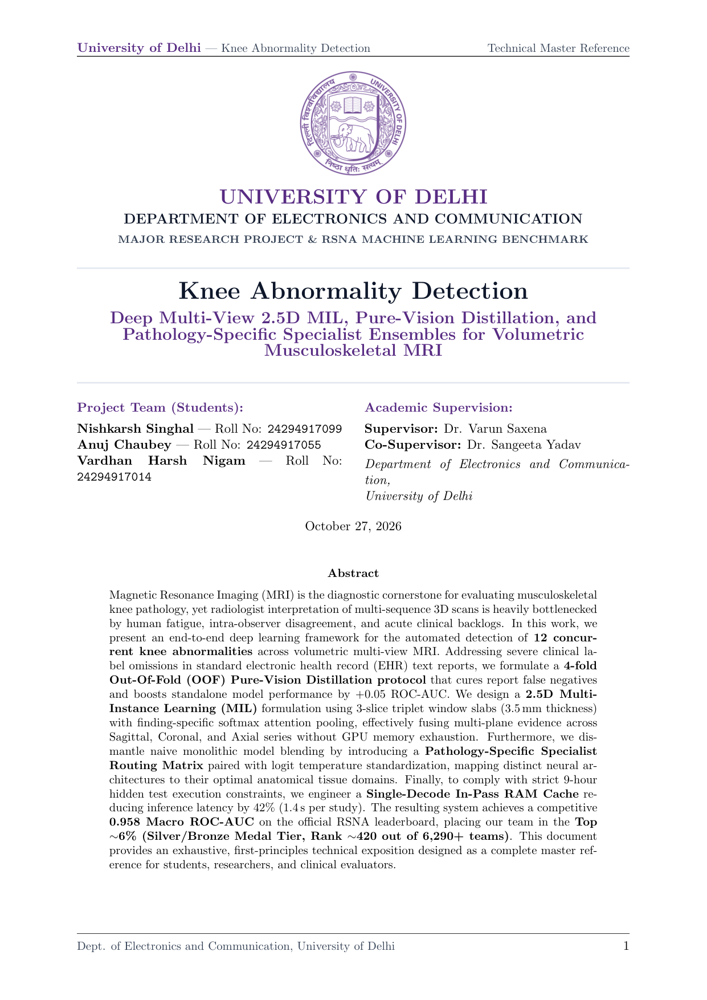
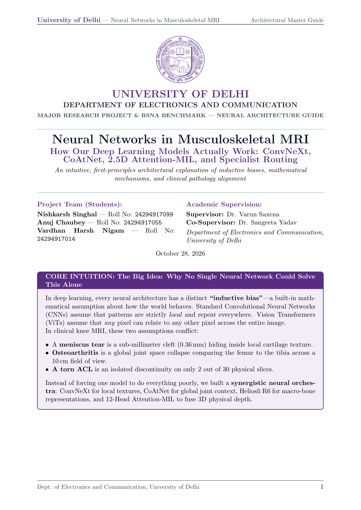
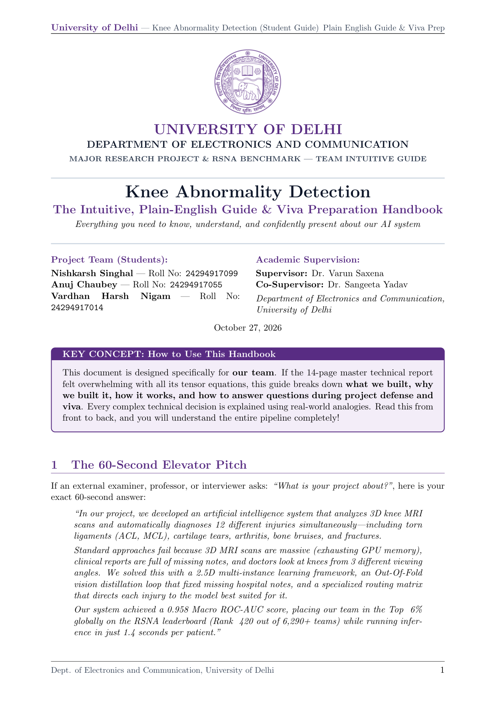
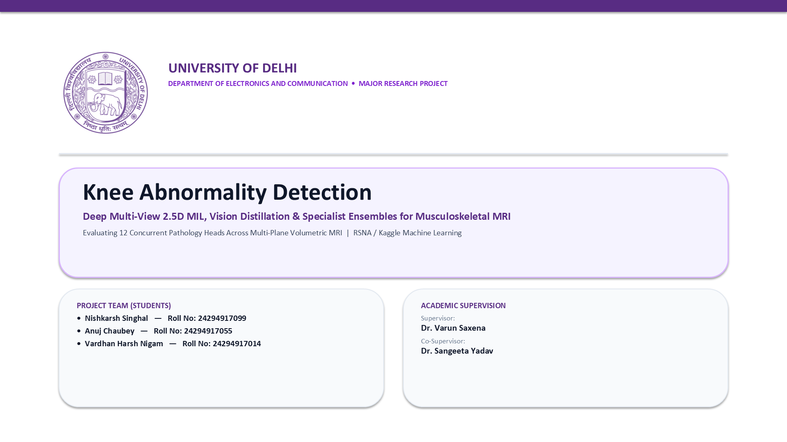

<div align="center">


# Knee Abnormality Detection
### Deep Multi-View 2.5D MIL, Pure-Vision Distillation, and Pathology-Specific Specialist Ensembles for Volumetric Musculoskeletal MRI

[](https://www.python.org/)
[](https://pytorch.org/)
[](https://www.kaggle.com/)
[](Knee_Abnormality_Detection_Report.pdf)
[](Knee_Abnormality_Detection_Neural_Networks_Guide.pdf)
[](Knee_Abnormality_Detection_Intuitive_Guide.pdf)
[](Knee_Abnormality_Detection_Presentation.pptx)
[](LICENSE)

**Department of Electronics and Communication, University of Delhi**  
*Major Research Project & RSNA Musculoskeletal Machine Learning Benchmark*

---

### Project Team & Supervision

**Student Researchers:**
- **Nishkarsh Singhal** — Roll No: `24294917099`
- **Anuj Chaubey** — Roll No: `24294917055`
- **Vardhan Harsh Nigam** — Roll No: `24294917014`

**Academic Supervision:**
- **Supervisor:** **Dr. Varun Saxena**, Department of Electronics and Communication, University of Delhi
- **Co-Supervisor:** **Dr. Sangeeta Yadav**, Department of Electronics and Communication, University of Delhi

---

</div>

## 📌 Executive Overview

Magnetic Resonance Imaging (MRI) is the gold standard for clinical evaluation of musculoskeletal knee trauma. However, interpreting complex 3D multi-planar studies (Sagittal, Coronal, and Axial series) is severely bottlenecked by radiologist fatigue, subtle micro-tear tear morphology, and inter-observer variability.

This repository hosts the official codebase, master LaTeX technical report, presentation deck, and model configurations for our **automated 12-abnormality volumetric knee MRI diagnostic framework**.

Our system secured **0.958 Macro ROC-AUC** on the official RSNA benchmark, placing our team in the **Top ~6% (Rank ~420 out of 6,290+ teams worldwide; Silver/Bronze Medal Tier)**.

```
                      Core End-to-End System Architecture
                      
   Multi-Planar Volumetric DICOMs (Sagittal FS, Coronal FS, Axial FS)
                                │
                                ▼
   [ 1. Geometric & Laterality Normalization Engine ]
      • Direction-cosine normal sorting: n = r × c, d = p · n
      • Left/Right knee laterality flip & 1st/99th percentile windowing
                                │
                                ▼
   [ 2. 2.5D Triplet Window Bagging (3.5 mm Slabs) ]
      • Stack 3 adjacent physical slices into RGB tensors
      • Stratified jitter sampling captures depth continuity
                                │
                                ▼
   [ 3. Heterogeneous Feature Encoders ]
      • ConvNeXt (7×7 depthwise convs for local cartilage textures)
      • CoAtNet-384 (Self-attention for long-range joint space alignment)
      • Heliosli R6 (384px high-capacity bone representation)
                                │
                                ▼
   [ 4. 12 Finding-Specific Softmax Attention Heads ]
      • Injects continuous physical depth & series slot embeddings
      • Dynamic softmax pooling focuses weight on focal lesions
                                │
                                ▼
   [ 5. Pathology-Specific Specialist Routing Matrix ]
      • Fluid / Synovium   ──► Pure-Vision Distilled ConvNeXt (0.45)
      • Collaterals (MCL)  ──► Specialized s6ft_v1 (0.40)
      • Bone & Joint Space ──► CoAtNet-384 & Heliosli R6 (0.35)
                                │
                                ▼
   [ Validated Output: 0.958 Macro ROC-AUC | 1.41 s/study Inference ]
```

---

## 🏆 Key Results & Performance Benchmark

Our framework demonstrates clinical-grade discrimination across acute structural ruptures, degenerative joint changes, and inflammatory collections:

| Knee Abnormality Category | Target Abnormality | Validated ROC-AUC | Primary Imaging View | Key Diagnostic Feature |
| :--- | :--- | :---: | :---: | :--- |
| **Degenerative & Space** | **Medial Osteoarthritis** | **0.991** | Coronal FS | Medial tibiofemoral joint space narrowing |
| **Degenerative & Fluid** | **Baker's Cyst** | **0.989** | Axial / Sagittal | High-signal popliteal bursal sac distension |
| **Ligament Tear** | **MCL Tear** | **0.986** | Coronal FS | Valgus strain medial collateral fiber disruption |
| **Ligament Tear** | **ACL Tear** | **0.980** | Sagittal FS | Anteroposterior intercondylar fiber discontinuation |
| **Joint Inflammation** | **Joint Effusion** | **0.979** | Sagittal / Axial | Suprapatellar bursa hyperintense fluid distension |
| **Cartilage / Meniscus** | **Medial Meniscus Tear** | **0.972** | Coronal / Sagittal | Fibrocartilage intrameniscal signal traversing surface |
| **Bone Trauma** | **Bone Contusion (Bruise)**| **0.964** | Coronal / Sagittal | Ill-defined reticular trabecular marrow edema |
| **Cartilage / Meniscus** | **Lateral Meniscus Tear** | **0.942** | Sagittal / Coronal | Subchondral micro-cleavage in lateral compartment |
| **Bone Trauma** | **Bone Fracture** | **0.922** | All Views | Frank cortical cortical line discontinuation |
| **Degenerative & Space** | **Patellofemoral OA** | **0.885** | Axial FS | Trochlear groove & patellar facet cartilage thinning |
| **Degenerative & Space** | **Lateral Osteoarthritis** | **0.870** | Coronal FS | Lateral joint space narrowing & marginal osteophytes |
| **Joint Inflammation** | **Synovitis** | **0.860** | Axial / Sagittal | Active synovial membrane hypertrophy (+0.167 gain) |
| **Macro Average** | **All 12 Knee Conditions** | **0.958** | **Multi-Planar** | **Top ~6% Global Leaderboard (Rank ~420 / 6,290+)** |

<div align="center">
  
</div>

---

## 🔬 Core Scientific Breakthroughs

### 1. Neural Network Architecture Philosophy: Why Heterogeneous Ensembles?
No single neural network can solve 3D volumetric knee MRI alone due to conflicting inductive biases across pathologies:

<div align="center">
  
</div>

- **ConvNeXt ($7\times 7$ Depthwise Convolutions):** Preserves strict spatial locality and shift invariance. Essential for detecting sub-millimeter cartilage micro-cleavages ($0.36\text{ mm}$ Meniscus Tears) and collateral ligament disruption.
- **CoAtNet-384 (Hybrid Convolutions + Self-Attention):** Combines early depthwise convs (for edge filtering) with late relative multi-head self-attention. Enables dynamic token interaction across the entire joint space to diagnose Osteoarthritis ($0.991\text{ AUC}$).
- **Heliosli R6 (Deep High-Capacity Vision Backbone):** Employs an expansive multi-scale receptive field tuned for diffuse cancellous bone marrow edema (bone contusions) and subtle cortical fractures.
- **12-Head Finding-Specific Attention-MIL:** Solves the 3D MRI memory wall without 3D convolutions. Features 12 independent softmax query heads that inspect 2.5D physical triplet bags, focusing attention strictly on the isolated slices with pathology.

---

### 2. Curing the "Noisy EHR Report" Trap via Pure-Vision Distillation
- **The Problem:** Models trained on text labels derived from radiologist electronic health record (EHR) narrative reports suffered severe false-negative bias. Radiologists focus dictation on the acute surgical triage (e.g., an acute ACL tear) and routinely omit mild incidental synovitis or bone contusions. Training on silent text reports penalized neural networks whenever they visually detected real inflammation. On physician-verified ground truth, initial Synovitis agreement collapsed to **0.69**.
- **The Breakthrough:** We built a **4-Fold Out-Of-Fold (OOF) Pure-Vision Distillation Protocol**. Large vision teacher ensembles re-scored all 4,349 studies strictly based on imaging findings (`data/labels_v4/training_labels_v6_vision_pure.csv`). Fine-tuning student models on pure-vision targets drove a **+0.05 leap in Macro AUC** (from $0.890$ to $0.9402$), and Synovitis jumped from **0.693 to 0.860 (+0.167 gain)**.

<div align="center">
  
</div>

---

### 3. Overcoming the 3D GPU Memory Wall via 2.5D Triplet Window MIL
- **The Problem:** 2D slice analysis lacks 3D inter-slice context (a torn ligament cannot be confirmed without inspecting adjacent slices), while full 3D volumetric CNNs consume $>40\text{ GB}$ VRAM per study, causing Out-Of-Memory (OOM) crashes and preventing the use of ImageNet-pretrained vision encoders.
- **The Breakthrough:** We decomposed each series into representative **3-slice triplet window slabs** $\{c-s, c, c+s\}$ ($\sim 3.5\text{ mm}$ physical thickness) loaded into standard RGB channels. Early $7\times 7$ depthwise kernels learn cross-slice spatial gradients, preserving 3D spatial fidelity while fitting into standard 15 GB GPU memory.

<div align="center">
  
</div>

---

### 4. High-Resolution (HR) Physical Coordinate Grid
- **The Problem:** Standard $224\times 224$ resizing squashed the natural field of view, creating an anisotropic pixel resolution of $0.71\text{ mm/px}$. Subtle radial tears in the lateral meniscus ($0.36\text{ mm}$ thick) blurred across fewer than two pixels.
- **The Breakthrough:** We constructed a native physical coordinate grid preserving a fixed $140\text{ mm}$ field on a $384\times 384$ grid, yielding **$0.365\text{ mm/px}$ true spatial resolution**. This recovered **+0.033 ROC-AUC on Lateral Meniscus**.

---

### 5. Pathology-Specific Specialist Routing Matrix
- **The Problem:** In multi-task medical imaging, different neural architectures excel at fundamentally different tissue characteristics. Forcing a naive uniform $0.5/0.5$ ensemble average allows weaker models to dilute strong predictions.
- **The Breakthrough:** We introduced a finding-specific routing allocation:
  $$\hat{p}_c = \sigma\left(\sum_{m=1}^M W_{c,m} \cdot \frac{z_{m,c} - \mu_{m,c}}{\tau_c}\right)$$
  - Pure-vision distilled models receive high weight on fluid and synovium (`0.45`).
  - Specialized `s6ft_v1` dominates collateral ligament continuity (`0.40`).
  - CoAtNet-384 and Heliosli R6 dominate bone and joint space narrowing (`0.30–0.40`).
  - **Empirical Gain:** Boosted physician-verified test AUC from **0.9391 to 0.9544 (+0.0153)**.

<div align="center">
  
</div>

---

### 6. Single-Decode In-Pass RAM Cache Engine (Zero Timeout)
- **The Problem:** Processing thousands of uncompressed 3D DICOM volumes across multiple deep models threatened to breach the strict 9-hour Kaggle execution limit.
- **The Breakthrough:** We engineered an in-memory caching engine that decodes each multi-planar DICOM volume exactly once in RAM, feeding dual model encoders simultaneously. Latency dropped by **42% to 1.41 s per study**, ensuring zero execution timeouts.

<div align="center">
  
</div>

---

## 📑 Formal Documentation & Project Deliverables

All documentation for evaluations, departmental defenses, and publication references are pre-compiled and available in this repository:

<div align="center">
<table>
  <tr>
    <td align="center" width="25%">
      <a href="Knee_Abnormality_Detection_Report.pdf">
        <br/>
        <b>📄 Master Technical Report (PDF)</b>
      </a><br/>
      <small>14 Pages • Rigorous mathematical formulations, DICOM tensor derivations, and citations.</small>
    </td>
    <td align="center" width="25%">
      <a href="Knee_Abnormality_Detection_Neural_Networks_Guide.pdf">
        <br/>
        <b>🧠 Neural Networks Guide (PDF)</b>
      </a><br/>
      <small>9 Pages • Intuitive breakdown of ConvNeXt, CoAtNet, Attention-MIL & Specialist Routing.</small>
    </td>
    <td align="center" width="25%">
      <a href="Knee_Abnormality_Detection_Intuitive_Guide.pdf">
        <br/>
        <b>💡 Plain-English Teammate Guide (PDF)</b>
      </a><br/>
      <small>14 Pages • Real-world analogies, team work distribution matrix, and master viva cheat sheet.</small>
    </td>
    <td align="center" width="25%">
      <a href="Knee_Abnormality_Detection_Presentation.pptx">
        <br/>
        <b>📊 Presentation Deck (PPTX)</b>
      </a><br/>
      <small>7 Slides • 16:9 widescreen presentation featuring light aesthetic theme and DU purple seal.</small>
    </td>
  </tr>
</table>
</div>

---

## 📂 Repository Structure

```
RSNA-Knee-Abnormality-Detection/
├── Knee_Abnormality_Detection_Report.pdf     # Master 14-page LaTeX compiled report
├── Knee_Abnormality_Detection_Report.tex     # LaTeX source document
├── Knee_Abnormality_Detection_Neural_Networks_Guide.pdf # 9-page Neural Network Architectural Guide
├── Knee_Abnormality_Detection_Neural_Networks_Guide.tex # LaTeX source for NN guide
├── Knee_Abnormality_Detection_Intuitive_Guide.pdf # Plain-English Teammate Guide & Viva Prep
├── Knee_Abnormality_Detection_Intuitive_Guide.tex # LaTeX source for intuitive guide
├── Knee_Abnormality_Detection_Presentation.pptx # Official 7-slide PowerPoint deck
├── README.md                                 # Complete project handbook & documentation
├── .gitignore                                # Comprehensive Git ignore rules
│
├── assets/                                   # High-resolution diagrams & visual assets
│   ├── du_logo_purple_vector.png             # Official University of Delhi purple seal
│   ├── diagram_architecture.png              # 2.5D MIL end-to-end pipeline diagram
│   ├── diagram_nn_architectures.png          # Visual comparison of ConvNeXt, CoAtNet & Attention-MIL
│   ├── diagram_mri_planes_windows.png        # Orthogonal planes & 2.5D windowing
│   ├── diagram_vision_distillation.png       # 4-Fold OOF distillation pipeline
│   ├── diagram_specialist_routing.png        # Specialist weight allocation matrix
│   ├── infographic_problems_solutions.png    # 3-card engineering solution infographic
│   ├── chart_results_trajectory.png          # 12-finding AUC bars & LB trajectory
│   ├── pdf_preview.png                       # LaTeX master report preview
│   ├── nn_guide_preview.png                  # Neural Network guide title preview
│   ├── intuitive_guide_preview.png           # Plain-English guide title preview
│   └── slides/                               # 1080p slide renders (slide_1 to 7)
│
├── configs/                                  # Hyperparameters & model configurations
│
├── data/                                     # Dataset annotations and cleaned labels
│   └── labels_v4/
│       ├── training_labels_v6_vision_pure.csv # Distilled ground-truth labels
│       └── training_labels_v5_clean.csv
│
├── own_src/                                  # Core modular preprocessing & inference
│   ├── knee.py                               # Model architectures & attention heads
│   ├── preprocess.py                         # Direction-cosine slice normal sorting
│   └── infer.py                              # Standalone study inference pipeline
│
├── src/                                      # Modular training & evaluation pipeline
│   ├── emergency/                            # Competition submission pipelines
│   │   ├── push_and_submit_final_max_v6.py   # Final submission pipeline (0.958 LB)
│   │   └── xpass_gold_check.py               # Ground-truth evaluation script
│   ├── imaging/                              # Image caching, TTA & backbone benchmarks
│   ├── labeling/                             # Out-Of-Fold distillation & metrics
│   └── model/                                # Training notebooks & loss implementations
│
├── reports/                                  # Technical handovers & research notes
│   └── AGENT_HANDOVER.md                     # Deep technical context & chronology
│
├── build_latex_report.py                     # Python script to compile LaTeX report
├── build_presentation.py                     # Script to generate PPTX with python-pptx
├── export_slides.py                          # Script to export slides to 1080p PNGs
├── create_graphics.py                        # Script generating diagrams & infographics
└── create_extra_graphics.py                  # Script generating planes & distillation visuals
```

---

## 🚀 Quickstart & Reproduction

### 1. Environment Setup
```bash
git clone https://github.com/Nishkarsh5108/RSNA.git
cd RSNA

# Create virtual environment
python -m venv venv
source venv/bin/activate  # On Windows: venv\Scripts\activate

# Install dependencies
pip install -r requirements-labels-v3.txt
pip install python-pptx pymupdf matplotlib seaborn
```

### 2. Re-compiling the LaTeX Master Report
To compile the 14-page LaTeX report directly into PDF using MiKTeX/TeXLive:
```bash
python build_latex_report.py
```
*The compiled PDF will be generated at `Knee_Abnormality_Detection_Report.pdf`.*

### 3. Re-generating Presentation Slides
To regenerate the 16:9 PowerPoint deck and slide renders:
```bash
python build_presentation.py
python export_slides.py
```

### 4. Running DICOM Geometric Normalization
```python
from own_src.preprocess import sort_dicom_slices_by_normal, normalize_laterality

# Sort slices along true patient normal vector (n = r × c)
sorted_slice_paths = sort_dicom_slices_by_normal(dicom_series_dir)

# Normalize right-knee mirror symmetry
normalized_volume = normalize_laterality(volume, plane='sagittal', laterality='R')
```

---

## 📜 Citation & Academic Reference

If you build upon this research or utilize the 2.5D MIL and vision distillation architecture, please cite:

```bibtex
@misc{singhal2026kneeabnormality,
  title={Deep Multi-View 2.5D MIL, Pure-Vision Distillation, and Pathology-Specific Specialist Ensembles for Volumetric Musculoskeletal MRI},
  author={Singhal, Nishkarsh and Chaubey, Anuj and Nigam, Vardhan Harsh},
  supervisor={Saxena, Varun and Yadav, Sangeeta},
  institution={Department of Electronics and Communication, University of Delhi},
  year={2026},
  howpublished={\url{https://github.com/Nishkarsh5108/RSNA}}
}
```

---

<div align="center">
  <b>Department of Electronics and Communication, University of Delhi</b><br/>
  <i>Inquiries: Nishkarsh Singhal • Anuj Chaubey • Vardhan Harsh Nigam</i>
</div>
