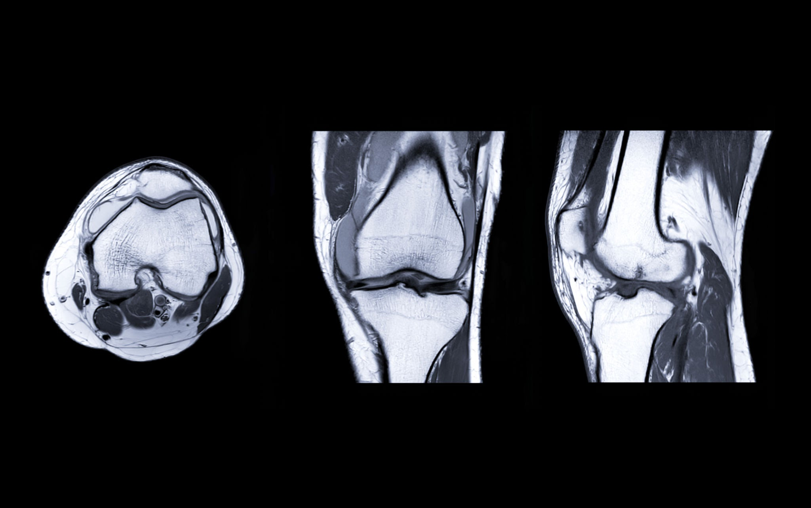
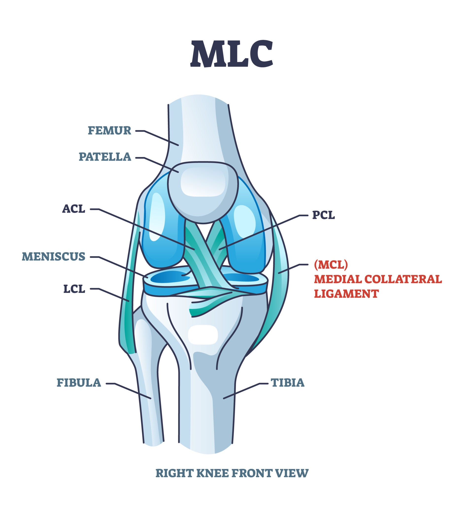

# ACL:

### 1. The Undisputed GOAT: MRNet

If you are touching knee MRIs, you literally start here. Stanford dropped this absolute banger back in 2018, and it's basically the benchmark everyone else tries to beat (Bien et al., 2018).

* **The Architecture:** They ran an AlexNet feature extractor on each individual MRI slice (sagittal, coronal, axial) and max-pooled the features across the slices before throwing them into a logistic regression layer.
* **The Dataset (The real treasure):** The [MRNet dataset](https://stanford.redivis.com/datasets/4a2c-4cpkzrn2c). It's got 1,370 actual knee MRI exams. It’s publicly available, but it's gated—you just gotta sign a quick research use agreement on the Stanford ML Group site to get the download link.
* **The Code:** GitHub is completely flooded with PyTorch implementations of this. Just search `ahmedbesbes/mrnet` for a super clean, ready-to-run version so you don't have to code it like a peasant.
* **AUC SCORE**: 0.88: `models\ACL\mrnet-master`
* **AUC SCORE**: 0.904: `models\ACL\MRNet-Competition-master`

### 2. The Segmentation Flex: U-Net for ACLs

If you don't just want a binary "yep, it's torn" classification but actually want to *segment* where the tear is (pixel-level mask), check out this setup (Awan et al., 2022).

* **The Architecture:** They modified a standard U-Net to draw exact masks over the ACL tear directly on the slices.
* **The Dataset:** They used clinical datasets, but if you need something instantly downloadable with zero red tape, look up the **KneeMRI dataset (by Štajduhar)** from Croatia. It's sitting right there on Kaggle and GitHub.
* **The Code:** U-Net architectures for this are heavily documented everywhere.

**References**
Bien, N., Rajpurkar, P., Ball, R. L., et al. (2018). Deep-learning-assisted diagnosis for knee magnetic resonance imaging: Development and retrospective validation of MRNet. *PLOS Medicine*, *15*, e1002699. [https://doi.org/10.1371/journal.pmed.1002699](https://doi.org/10.1371/journal.pmed.1002699)
Cited by: 928

Awan, M. J., Rahim, M. S. M., Salim, N., Rehman, A., & Garcia-Zapirain, B. (2022). Automated Knee MR Images Segmentation of Anterior Cruciate Ligament Tears. *Sensors*, *22*, 1552. [https://doi.org/10.3390/s22041552](https://doi.org/10.3390/s22041552)
Cited by: 53

# MCL:

### 1. The Gold Standard Open Dataset: fastMRI+ (Meta AI / NYU Langone)

If you need an open dataset with explicit labels for MCL tears, this is the main one to use (Zhao et al., 2022).

* **The Dataset:** Built on top of the massive NYU fastMRI initiative (1,172 fully sampled raw knee MRI studies). Subspecialist radiologists went in and annotated the scans with 16,000+ bounding boxes and study-level labels.
* **The MCL Labels:** Unlike standard datasets that lump everything into "abnormal," `fastMRI+` explicitly breaks down collateral ligament injuries into **MCL High-Grade Sprain (Tear)** and **MCL Low-Moderate Grade Sprain**.
* **The Code:** Meta AI’s official `facebookresearch/fastMRI` GitHub repo provides PyTorch implementations (U-Nets, End-to-End Variational Networks) for processing the raw coronal T2/PD series.

### 2. Multi-Condition Analysis: 3D Slice Transformer

For a modern model built to detect multi-ligament damage (Vuskov et al., 2025).

* **The Architecture:** Uses a **3D Slice Transformer** network. It extracts spatial feature representations from coronal image stacks using a ResNet backbone and passes the slice embeddings through multi-head self-attention layers to make a binary decision on MCL integrity.
* **Performance:** Evaluated across 3,000+ knee MRI exams from multiple scanner vendors (Philips, Siemens 1.5T/3T) to ensure the model doesn't overfit to a single machine's noise profile.

### 3. Adapting Open-Source MRNet Architectures for MCL

You don't need a brand-new architecture for MCL—you just need to change the input plane and slice-pooling logic:

* **Pipeline Setup:** Take an open-source PyTorch implementation of MRNet (e.g., `ahmedbesbes/mrnet` or `vijaykvganaraju/knee-tear-detection`).
* **Modification:** Feed **only the coronal series stack** through the ResNet-50 feature extractor. Max-pool across the coronal slices, and swap the final classification head to output the MCL logit using loss-weighted BCE (since MCL tears are less frequent than meniscus/ACL tears in general populations).

**References**
Zhao, R., Yaman, B., Zhang, Y., et al. (2022). fastMRI+: Clinical pathology annotations for knee and brain fully sampled magnetic resonance imaging data. *Scientific Data*, *9*, 152. [https://doi.org/10.1038/s41597-022-01255-z](https://doi.org/10.1038/s41597-022-01255-z)

Cited by: 73

Vuskov, R., et al. (2025). Comprehensive deep learning-assisted multi-condition analysis of knee MRI. *European Radiology* / *PMC13035746*.

Cited by: 5
