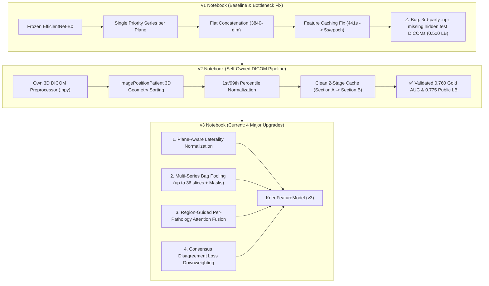
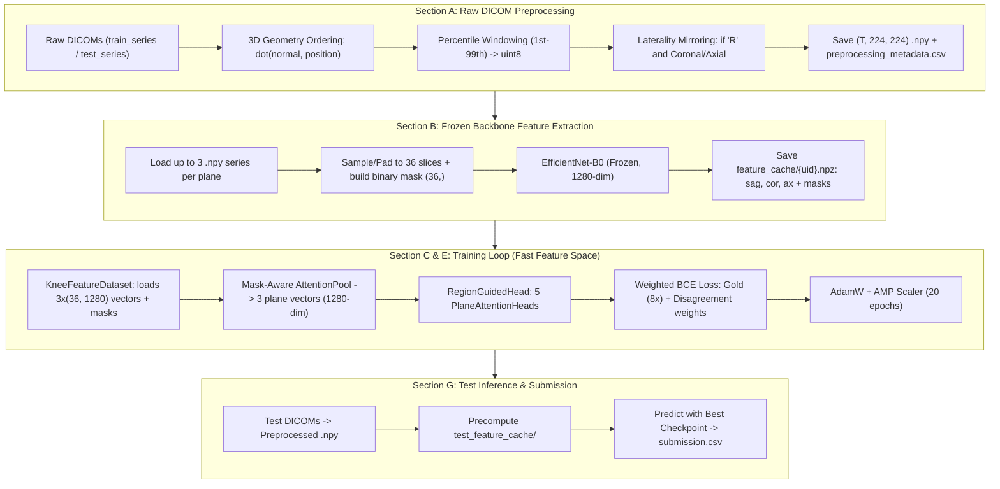

# Knee MRI Modeling: Technical Overview & Deep-Dive (v1 → v2 → v3)

**Author / Context**: Written by Nishkarsh for Manya  
**Target File**: [`src/model/knee_mri_v3_training.ipynb`](file:///d:/Coding/kaggle/RSNA/src/model/knee_mri_v3_training.ipynb)  
**Notebook References**: [`src/model/knee_mri_v1_training.ipynb`](file:///d:/Coding/kaggle/RSNA/src/model/knee_mri_v1_training.ipynb), [`src/model/knee_mri_v2_training.ipynb`](file:///d:/Coding/kaggle/RSNA/src/model/knee_mri_v2_training.ipynb)

---

## 1. Executive Summary & Big Picture

Hey Manya! Here is a complete breakdown of what is happening in our training pipeline, focusing on **`knee_mri_v3_training.ipynb`**, how we got here from **`v1`** and **`v2`**, and all the technical decisions behind the architecture.

### The Core Problem We Are Solving
In the RSNA Knee Abnormality Detection competition, for each patient knee exam (`StudyInstanceUID`), we must predict the presence of **12 distinct abnormalities** across 3 anatomical MRI planes (**Sagittal**, **Coronal**, **Axial**):
- **Ligament**: `ACL`, `MCL`
- **Meniscus**: `Medial Meniscus`, `Lateral Meniscus`
- **Osteoarthritis (OA)**: `Medial OA`, `Lateral OA`, `PF OA`
- **Fluid & Synovium**: `Effusion`, `Synovitis`, `Baker's`
- **Bone / Trauma**: `Contusion`, `Fracture`

### The Critical Data Constraint: The "58 Gold" Dilemma
- We have **4,407 training studies** in total.
- However, only **58 studies** have true, verified radiologist ground-truth labels (**Gold labels**).
- The remaining ~4,349 studies have soft consensus pseudo-labels derived from multimodal LLM parsing.
- **Why we don't train 12 separate single-pathology models**: SOTA papers (MRNet, SGNET, Keros) achieve 0.96+ AUC by training on thousands of expert labels per pathology. If we split into 12 single models, we fragment our tiny 58-gold budget and destroy **cross-pathology representation sharing** (e.g., bone contusions correlating with ACL tears). Therefore, a unified, joint multi-label architecture is non-negotiable.

---

## 2. Evolution Across Notebook Versions: How We Got to `v3`



### Detailed Version Comparison Table

| Technical Feature | `v1` ([`knee_mri_v1_training.ipynb`](file:///d:/Coding/kaggle/RSNA/src/model/knee_mri_v1_training.ipynb)) | `v2` ([`knee_mri_v2_training.ipynb`](file:///d:/Coding/kaggle/RSNA/src/model/knee_mri_v2_training.ipynb)) | `v3` ([`knee_mri_v3_training.ipynb`](file:///d:/Coding/kaggle/RSNA/src/model/knee_mri_v3_training.ipynb)) |
| :--- | :--- | :--- | :--- |
| **Data Ingestion** | 3rd-party `.npz` archive with fallback. | Raw official DICOMs processed into uncompressed `.npy`. | Raw official DICOMs processed into uncompressed `.npy` + metadata tracking. |
| **Laterality Alignment** | None (left as acquired). | None (left as acquired). | **Coronal & Axial right knees (`Laterality=='R'`) mirrored horizontally**. Sagittal is kept intact. |
| **Series per Plane** | 1 priority series per plane (fluid-sensitive preferred). | 1 priority series per plane (fluid-sensitive preferred). | **Multi-Series Pooling**: up to `MAX_SERIES_PER_PLANE=3` series per plane (captures ~15% extra data). |
| **Slice Count & Masking** | 12 fixed slices per plane. No masks. | 12 fixed slices per plane. No masks. | **36 slice slots per plane** (`3 * 12`) + binary validity mask `(36,)`. |
| **Slice Pooling** | Standard `AttentionPool` | Standard `AttentionPool` | **Mask-Aware `AttentionPool`** (ignores zero-padding). |
| **Plane Fusion Head** | Flat concatenation $[s, c, a]$ ($3840\text{d}$) $\rightarrow$ MLP. | Flat concatenation $[s, c, a]$ ($3840\text{d}$) $\rightarrow$ MLP. | **`RegionGuidedHead`**: 5 anatomical sub-heads with learned plane attention. |
| **Loss Formulation** | BCE + `pos_weight` + `GOLD_WEIGHT=8.0`. | BCE + `pos_weight` + `GOLD_WEIGHT=8.0`. | BCE + `pos_weight` + `GOLD_WEIGHT=8.0` + **disagreement confidence weighting**. |
| **Cache Format** | `(12, 1280)` in `.npz` per study. | `(12, 1280)` in `.npz` per study. | `(36, 1280)` features + `(36,)` masks in `.npz` per study. |
| **Validation Result** | ~0.750 honest gold AUC. | **0.7601** honest gold AUC (**0.775 Public LB**). | **0.7294** Fold-0 honest gold AUC / 0.7705 noisy AUC. |

---

## 3. The 4 Technical Pillars of `v3` Explained

### Pillar 1: Plane-Aware Laterality Normalization
*   **The Problem**: A human knee scan can be of the Left ('L') or Right ('R') knee. In standard viewing, the lateral compartment of a right knee appears on the opposite side of the image compared to a left knee. This forces the CNN backbone to learn two mirror representations for every meniscus and collateral ligament tear.
*   **The Fix**: When `Laterality == 'R'`, we mirror the 2D image matrix horizontally (`stack = stack[:, :, ::-1]`).
*   **The Crucial Anatomical Nuance**:
    - **Coronal & Axial**: The image column axis directly corresponds to the patient's anatomical Medial-Lateral axis. **Flipping aligns medial/lateral compartments.**
    - **Sagittal**: The image column axis corresponds to the **Anterior-Posterior** (front-to-back) axis, which is independent of left/right knee laterality.
    - *Lesson learned*: In early experiments, flipping sagittal series caused an ACL performance drop because the ACL orientation was artificially reversed. `v3` explicitly restricts flipping to Coronal and Axial planes only:
      ```python
      if laterality == 'R' and anatomical_plane in ('Coronal', 'Axial'):
          stack = stack[:, :, ::-1]  # mirror left-right
          mirrored = True
      ```

### Pillar 2: Multi-Series Bag Pooling with Attention Masks
*   **The Problem**: In `v1` and `v2`, we selected only 1 "priority series" per plane (preferring `Fluid_Sensitive == 1`). But in reality, ~65% of study-plane groups have 2 or more series (e.g., both a T1 plain acquisition and a T2 fat-suppressed acquisition). We were throwing away ~15% of the total diagnostic information.
*   **The Fix**:
    - For each plane, we now load up to `MAX_SERIES_PER_PLANE = 3` series (fluid-sensitive first).
    - Each series is sampled to `N_SLICES = 12`.
    - We concatenate them into a bag of `3 * 12 = 36` slice slots.
    - If a study only has 1 or 2 series for that plane, the missing slots are zero-padded, and a binary mask `(36,)` is constructed (`1.0` for real slices, `0.0` for padding).
*   **Mask-Aware Attention Pooling**:
    To prevent padded zero-slices from degrading the softmax denominator, `AttentionPool` applies `-inf` masking:
    ```python
    class AttentionPool(nn.Module):
        def __init__(self, dim, hidden=128):
            super().__init__()
            self.attn = nn.Sequential(nn.Linear(dim, hidden), nn.Tanh(), nn.Linear(hidden, 1))

        def forward(self, x, mask=None):  # x: (B, 36, 1280), mask: (B, 36)
            scores = self.attn(x)         # (B, 36, 1)
            if mask is not None:
                invalid = (mask == 0).unsqueeze(-1)
                all_invalid = invalid.all(dim=1, keepdim=True)
                scores = scores.masked_fill(invalid & ~all_invalid, float('-inf'))
            w = torch.softmax(scores, dim=1)
            return (x * w).sum(dim=1)     # (B, 1280)
    ```

### Pillar 3: Region-Guided Per-Pathology Attention Fusion
*   **The Problem**: In `v1`/`v2`, plane embeddings were simply concatenated: $[s, c, a] \in \mathbb{R}^{3840}$. A single MLP head had to learn all 12 targets from this rigid vector. However, clinical MRI diagnosis is plane-specific:
    - ACL tears are primarily diagnosed on **Sagittal** views.
    - Collateral ligaments (MCL) and meniscus body tears are best seen on **Coronal** views.
    - Patellofemoral osteoarthritis and joint effusions are prominently assessed on **Axial** views.
*   **The Fix**: Group the 12 targets into 5 clinical anatomical regions:
    ```python
    REGION_GROUPS = {
        'ligament': ['ACL', 'MCL'],
        'meniscus': ['Medial Meniscus', 'Lateral Meniscus'],
        'oa':       ['Medial OA', 'Lateral OA', 'PF OA'],
        'fluid':    ['Effusion', 'Synovitis', "Baker's"],
        'trauma':   ['Contusion', 'Fracture'],
    }
    ```
*   **Architecture**:
    - Slices from each plane are pooled into 3 vectors: $s, c, a \in \mathbb{R}^{1280}$.
    - Stack into `plane_embeds` $\in \mathbb{R}^{B \times 3 \times 1280}$.
    - For each anatomical group, a dedicated `PlaneAttentionHead` computes a 3-way softmax weight over the planes, producing a dynamic, pathology-specific fused representation:
      $$\mathbf{w}_{\text{group}} = \text{softmax}(\text{Linear}(\tanh(\text{Linear}(\text{plane\_embeds})))) \in \mathbb{R}^{B \times 3 \times 1}$$
      $$\mathbf{f}_{\text{group}} = \sum_{p \in \{\text{sag, cor, ax}\}} w_p \cdot \mathbf{embed}_p \in \mathbb{R}^{B \times 1280}$$
      $$\text{logits}_{\text{group}} = \text{Classifier}(\mathbf{f}_{\text{group}})$$

### Pillar 4: Consensus Disagreement Loss Weighting
*   **The Problem**: Training purely on pseudo-labels introduces noise. When label-generation models strongly disagree on a case, forcing the network to fit that pseudo-label with full gradient strength degrades feature representations.
*   **The Fix**: `train_folds_consensus.csv` contains `_disagreement` metrics per column. We compute a per-label confidence weight:
    $$\text{confidence}_{i} = \text{clip}(1.0 - \text{disagreement}_i, \, 0.2, \, 1.0)$$
*   **Loss Formulation**:
    $$\mathcal{L} = \frac{\sum_{b} \text{row\_weight}_b \cdot \frac{1}{12}\sum_{i=1}^{12} \text{label\_weight}_{b, i} \cdot \text{BCEWithLogits}(\hat{y}_{b,i}, y_{b,i}; \text{pos\_weight}_i)}{\sum_b \text{row\_weight}_b}$$
    Where:
    - $\text{row\_weight}_b = 8.0$ if study $b$ is one of the 58 Gold studies, else $1.0$.
    - $\text{label\_weight}_{b, i} = \text{confidence}_{b, i}$.
    - $\text{pos\_weight}_i = \text{clip}\left(\frac{1 - \text{prev}_i}{\text{prev}_i}, 1.0, 10.0\right)$ to handle class imbalance.

---

## 4. End-to-End Pipeline Architecture in `v3`



---

## 5. Tensor Shapes & Mathematical Specifications

### Tensor Dimensionality Walkthrough

```
1. Preprocessed Series on Disk:
   Array shape: (T, 224, 224), uint8 (where T is variable original slice count)

2. Bag Formation (DataLoader / Precompute):
   Plane Slices: (B, 36, 3, 224, 224)  [3 series x 12 slices]
   Plane Masks:  (B, 36)                [1.0 = valid, 0.0 = padded]

3. Backbone Feature Extraction:
   Input:   (B * 36, 3, 224, 224)
   Backbone: EfficientNet-B0 features -> AdaptiveAvgPool2d(1) -> Flatten
   Output:  (B, 36, 1280) float32 per plane

4. Slice Attention Pooling (per plane):
   Scores:    attn(x) -> (B, 36, 1)
   Masking:   masked_fill(mask == 0, -inf)
   Weights:   softmax(scores, dim=1) -> (B, 36, 1)
   Pooled:    sum(x * w, dim=1) -> (B, 1280)

5. Plane Stacking:
   plane_embeds = torch.stack([s, c, a], dim=1) -> (B, 3, 1280)

6. Region-Guided Head (evaluated per group):
   Plane Attention: softmax(attn(plane_embeds), dim=1) -> (B, 3, 1)
   Fused Vector:    sum(plane_embeds * w, dim=1) -> (B, 1280)
   Classification:  Linear(1280, 128) -> ReLU -> Dropout(0.3) -> Linear(128, N_targets)
   Final Logits:    (B, 12)
```

---

## 6. Execution Results & Validation Metrics

### Preprocessing & Feature Extraction Stats
- **Train Series Preprocessed**: 9,808 series processed in 1,728s (~5.67 series/s) with **0 failures**.
- **Laterality Tag Distribution**: 5,208 missing, 2,305 'R' (mirrored), 2,274 'L', 23 'RIGHT', 11 'LEFT', 2 'B'.
- **Feature Precomputation**: 4,407 train studies computed in 902s (~4.88 studies/s) into the `v3` masked format.

### Training & Out-of-Fold Validation (Fold 0)
- **Training Setup**: 20 epochs, AdamW ($\text{LR}=10^{-3}$, weight decay $=10^{-4}$), Mixed Precision (AMP), batch size 32.
- **Best Fold 0 Honest Gold AUC**: **0.7294** (at Epoch 4).
- **Noisy Pseudo-Label AUC**: **0.7705**.

### Per-Class Honest AUC Breakdown on Gold Labels:
- `Lateral OA`: **1.0000**
- `Contusion`: **0.9524**
- `Medial OA`: **0.8611**
- `Fracture`: **0.8333**
- `Effusion`: **0.8056**
- `ACL`: **0.7222**
- `Baker's`: **0.6944**
- `MCL`: **0.6364**
- `Synovitis`: **0.5952**
- `Lateral Meniscus`: **0.5714**
- `Medial Meniscus`: **0.5476**
- `PF OA`: **0.5333**

---

## 7. Important Operational Gotchas & Engineering Details

1. **Cache Incompatibility with `v2`**:
   The Kaggle dataset `cached-features-train-data` generated from `v2` cannot be reused for `v3`. `v3` requires `(36, 1280)` feature tensors and `(36,)` binary mask arrays per plane.
2. **Kaggle Read-Only Symlink Protection**:
   In `v3`, test features are cached in `TEST_FEATURE_CACHE_DIR = f'{OUTPUT_DIR}/test_feature_cache'`. If we try to write test features into a symlinked Kaggle dataset folder, the commit run crashes with a read-only filesystem error.
3. **Kaggle Offline Weights Requirement**:
   Kaggle submission commits run with **Internet OFF**. `SliceBackbone` checks `EFFICIENTNET_WEIGHTS_PATH`. When uploading to Kaggle, point this parameter to your pre-uploaded weights dataset; otherwise, `torchvision` tries to download over HTTP and crashes before inference.
4. **Fast Training Loop**:
   Because backbone forward passes are executed only once during precomputation, training the pooling layers and classifier heads takes **only ~7 seconds per epoch** on a GPU.

---

## 8. Roadmap for `v4`

1. **Phase-2 End-to-End Fine-Tuning**: Unfreeze the top 1–2 convolutional blocks of the backbone with a lower learning rate ($10^{-5}$) once the head has converged.
2. **Backbone Upgrade to DINOv2-Small / ConvNeXt-Tiny**: Leverage stronger self-supervised spatial features.
3. **Geometry-Based Laterality Fallback**: For the ~53% of series missing the DICOM `Laterality` tag, infer knee side from patient positioning geometry (`PatientPosition`, `ImageOrientationPatient`).
4. **5-Fold Ensembling**: Train all 5 folds and ensemble prediction probabilities.
