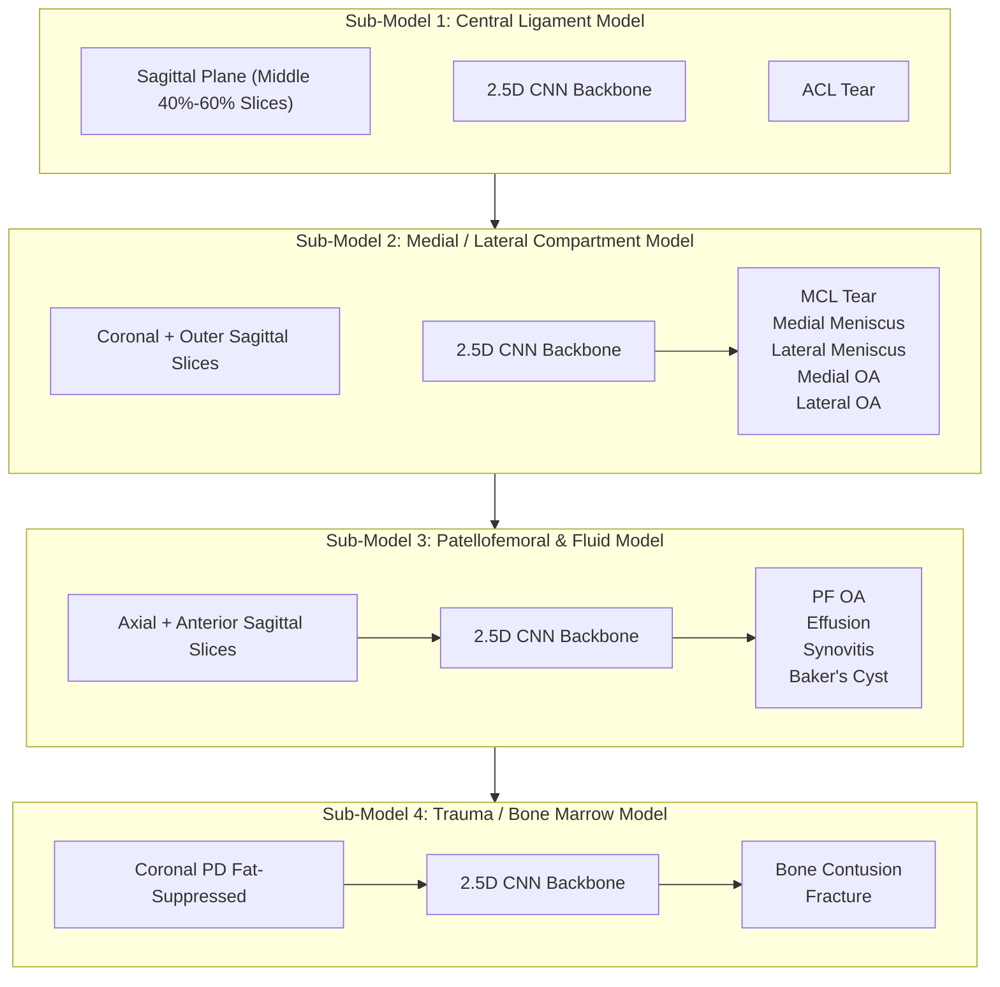

Listed directory RMSA
Viewed notes.ipynb:1-134
Searched web: ""RSNA Knee Abnormality Detection" kaggle"
Searched web: ""rsna-knee-abnormality-detection" OR "RSNA Knee Abnormality Detection" series slices kaggle"
Searched web: ""RSNA Knee Abnormality Detection" preprocessed dataset png npz kaggle"

Handling a massive **~570 GB DICOM MRI dataset** with limited resources (**Kaggle Notebooks** and a **6GB RTX 4050 laptop**) is one of the most classic challenges in medical computer vision competitions.

The good news is: **Top Kaggle Grandmasters almost never train models directly on raw 570GB DICOMs.** Instead, they use a structured methodology to shrink the data volume, divide the training into modular stages, and train lightweight, high-performance architectures.

Here is a breakdown of all the ways you can partition, compress, and train on this dataset within your hardware constraints.

---

```
                                  [ RAW DICOM: ~570 GB ]
                                             │
               ┌─────────────────────────────┴─────────────────────────────┐
               ▼                                                           ▼
    [ Route A: Community NPZ ]                                  [ Route B: Custom Chunker ]
   Attach public preprocessed 3D                               Parallel Kaggle background jobs
   volumes dataset (~15-25 GB)                                (e.g., 4 notebooks × 25% data)
               │                                                           │
               └─────────────────────────────┬─────────────────────────────┘
                                             ▼
                               [ PREPROCESSED DATA: ~20 GB ]
                                             │
               ┌─────────────────────────────┼─────────────────────────────┐
               ▼                             ▼                             ▼
       [ Plane Splitting ]           [ 5-Fold Splitting ]        [ 2-Stage Stacking ]
     • Model 1: Sagittal (ACL/Eff)   • Fold 0 Notebook (80/20)   • Stage 1: 2.5D Backbones
     • Model 2: Coronal (MCL/OA)     • Fold 1 Notebook (80/20)   • Stage 2: LightGBM / MLP
     • Model 3: Axial (Cyst/PFOA)    • Parallel Execution          on pooled features
```

---

### Strategy 1: Data Volume Reduction (Shrink 570 GB $\rightarrow$ 15–25 GB)

Raw DICOMs are massive because they contain uncompressed 16-bit pixel data, raw resolutions ($512 \times 512$), slice depth variations ($20$ to $100+$ slices per series), and header metadata.

#### 1. Resampling & Resolution Downscaling

* **Spatial Resize:** Downscale slices from $512 \times 512$ to **$224 \times 224$** or **$256 \times 256$**. In MRI, knee joint pathology (ligament tears, cartilage wear) remains clearly visible at $256 \times 256$.
* **Slice Depth Resampling:** Uniformly sample a fixed depth (e.g., **$24$ or $32$ slices**) per series.
* **8-bit / 16-bit Normalization:** Clip pixel intensity (1st to 99th percentile) and convert to `uint8` ($0-255$).
* **File Format:** Save each series as a compressed **`.npz`** or **`.h5`** file.

$$
\text{Single Series Size} = 32 \text{ slices} \times 256 \times 256 \times 1 \text{ byte (uint8)} \approx \mathbf{2.09 \text{ MB}}
$$

For $\sim 24,000$ series, the total dataset shrinks to **$\sim 18\text{--}25\text{ GB}$**, which easily fits into Kaggle's 73 GB disk space.

#### 2. How to obtain this without running out of Kaggle Disk

* **Option A (Instant - Recommended):** Kaggle has a public preprocessed dataset created for this competition: **`RSNA Knee MRI - Processed 3D Volumes`** (search in Kaggle Datasets). You can simply click **"Add Input"** to your notebook — it mounts virtually without taking up your notebook's disk space.
* **Option B (Custom Partitioning):** If you want your own custom preprocessing:
  1. Create 4 separate Kaggle notebooks.
  2. Notebook 1 processes `study_id` $0 \rightarrow 25\%$, Notebook 2 processes $25 \rightarrow 50\%$, etc.
  3. Save the outputs as 4 Kaggle Datasets (`rsna-knee-part-1`, `part-2`, etc.) and attach all 4 to your training notebook.

---

### Strategy 2: Splitting Methods for Training

Instead of training one monolithic model on the entire dataset at once, you can divide the problem along three natural axes:

#### 1. Split by Plane (Sagittal vs. Coronal vs. Axial)

As noted in your competition notes, knee pathologies are anatomically best visible from specific views:

* **Sagittal Model:** Trained only on sagittal series $\rightarrow$ outputs predictions for `ACL`, `Effusion`, `Medial Meniscus`, `Lateral Meniscus`.
* **Coronal Model:** Trained only on coronal series $\rightarrow$ outputs predictions for `MCL`, `Medial OA`, `Lateral OA`, `Contusion`.
* **Axial Model:** Trained only on axial series $\rightarrow$ outputs predictions for `PF OA`, `Baker's Cyst`, `Synovitis`.

**Benefits:**

* Each notebook only loads **$\sim 33\%$ of the series**.
* Training completes $3\times$ faster per model.
* Specialized feature extractors prevent gradient interference between conflicting anatomical views.

#### 2. Stratified Group K-Fold (Fold-by-Fold Training)

* Split the dataset into 5 folds grouped by `study_id` (to prevent data leakage across series of the same patient).
* Train **Fold 0** in **Notebook A**, **Fold 1** in **Notebook B**, etc.
* You can run multiple Kaggle background runs simultaneously.
* Save the weights (`fold0_best.pth`, `fold1_best.pth`, etc.) as dataset artifacts, then ensemble them during inference.

#### 3. Two-Stage Pipeline (Feature Extraction $\rightarrow$ Tabular Stacking)

* **Stage 1 (Feature Extractor):** Train 2.5D slice encoders on a subset or per-plane basis. Freeze the CNN and extract a 1D embedding vector (e.g., 512 dimensions) for each series/study.
* **Stage 2 (Meta-Classifier):** Train a **LightGBM / CatBoost / MLP** on the extracted embeddings + clinical text metadata. This stage trains in under 2 minutes on CPU or your RTX 4050 laptop.

---

### Strategy 3: Memory-Efficient Architectures for 6GB VRAM & Kaggle GPUs

To train 3D/2.5D MRI models without running out of CUDA memory (OOM), use the **2.5D CNN + Slice Aggregator** paradigm:

```
[ Input: (Batch, 24 Slices, 1, 256, 256) ]
                    │
                    ▼
[ Reshape to (Batch * 24, 1, 256, 256) ]
                    │
                    ▼
[ 2D Backbone (e.g. Timm EfficientNet-B0 / ResNet34) ]
                    │
                    ▼
[ Slices Features: (Batch, 24, 512) ]
                    │
                    ▼
[ Slice Aggregator: Attention Pooling / 1D Conv / Transformer / GRU ]
                    │
                    ▼
[ Study-Level Output: (Batch, 12 Targets) ]
```

#### PyTorch Memory Optimization Boilerplate

This configuration ensures training fits comfortably within your **RTX 4050 6GB VRAM** or Kaggle's T4 GPU:

```python
import torch
import torch.nn as nn
from torch.cuda.amp import autocast, GradScaler

# 1. 2.5D Model Definition
class RSNAKnee25D(nn.Module):
    def __init__(self, backbone, num_classes=12):
        super().__init__()
        self.encoder = backbone  # e.g. timm.create_model('resnet34', num_classes=0)
        self.attn_pool = nn.Sequential(
            nn.Linear(512, 128),
            nn.Tanh(),
            nn.Linear(128, 1),
            nn.Softmax(dim=1)
        )
        self.classifier = nn.Linear(512, num_classes)
  
    def forward(self, x):
        # x shape: (B, S, C, H, W) where S = num_slices (e.g. 24)
        B, S, C, H, W = x.shape
        x = x.view(B * S, C, H, W)
        feats = self.encoder(x)  # (B * S, 512)
        feats = feats.view(B, S, -1)  # (B, S, 512)
  
        # Attention pooling across slices
        weights = self.attn_pool(feats)  # (B, S, 1)
        pooled = (feats * weights).sum(dim=1)  # (B, 512)
        return self.classifier(pooled)

# 2. Memory-Efficient Training Loop
scaler = GradScaler()
accum_steps = 4  # Simulates batch_size = 4 * 4 = 16

for step, (images, targets) in enumerate(dataloader):
    images = images.to(device)   # Small physical batch: 4
    targets = targets.to(device)
  
    with autocast(dtype=torch.float16): # Halves VRAM usage
        outputs = model(images)
        loss = criterion(outputs, targets) / accum_steps
  
    scaler.scale(loss).backward()
  
    if (step + 1) % accum_steps == 0:
        scaler.step(optimizer)
        scaler.update()
        optimizer.zero_grad()
```

---

### Strategy 4: Division of Labor (Laptop vs. Kaggle Cloud)

| Task                                 | Device                                 | Why                                                                                                                            |
| :----------------------------------- | :------------------------------------- | :----------------------------------------------------------------------------------------------------------------------------- |
| **Pipeline & EDA Prototyping** | **RTX 4050 Laptop**              | Fast iteration on 100 sample`.npz` files. Test loss functions, dataloaders, augmentations without waiting for Kaggle queues. |
| **Dataset Conversion**         | **Kaggle (or Community NPZ)**    | Download/process directly on Kaggle cloud or attach the pre-converted community dataset.                                       |
| **Full Model Training**        | **Kaggle Notebooks (T4 / P100)** | Run 5 folds or 3 plane models in parallel via background commits (`Save Version` $\rightarrow$ `Run all`).               |
| **Meta-model / Stacking**      | **RTX 4050 Laptop / Kaggle**     | LightGBM/XGBoost on extracted embeddings runs in minutes locally.                                                              |
| **Final Inference Submission** | **Kaggle Submission Notebook**   | Load saved weights and run test inference within Kaggle's 9-hour submission budget.                                            |

---

### Suggested Next Steps

1. **Test Data Loading:** Would you like to inspect a starter script to load and visualize the `.npz` 3D series volumes (Sagittal, Coronal, Axial) using PyTorch?
2. **Build the Baseline:** We can create a modular training pipeline with cross-validation and attention pooling ready to run on Kaggle.

---

### Part 1: How the Data Looks & Is Structured

The dataset contains **4,407 knee MRI studies** ($\sim 24,371$ total series) taking up **$\sim 570\text{ GB}$**.

```
kaggle/input/rsna-knee-abnormality-detection/
├── train.csv                     <-- Study IDs, labels (58 studies), and raw radiology Reports (4,349 studies)
├── sample_submission.csv         <-- 12 target columns to predict
└── train_images/                 <-- ~570 GB of raw DICOMs
    ├── <study_id_1>/
    │   ├── <series_id_A>/        <-- e.g. Sagittal PD-FS (30-60 slices)
    │   │   ├── 1.dcm
    │   │   ├── 2.dcm
    │   │   └── ...
    │   ├── <series_id_B>/        <-- e.g. Coronal T1 (20-40 slices)
    │   └── <series_id_C>/        <-- e.g. Axial T2 (25-45 slices)
    └── <study_id_2>/
        └── ...
```

#### 1. What a Single Patient Study Looks Like

An MRI exam is **multi-sequence** and **multi-planar**. A single `study_id` typically contains **3 to 6 series** taken at different angles and magnetic pulse sequences:

1. **Sagittal Series** (Side view: left $\leftrightarrow$ right cross-sections)
2. **Coronal Series** (Front view: anterior $\leftrightarrow$ posterior cross-sections)
3. **Axial Series** (Top-down view: thigh $\leftrightarrow$ calf cross-sections)

#### 2. What a Single DICOM Slice Contains

* **Image Array:** Raw $512 \times 512$ array of 16-bit integers (Hounsfield/intensity values ranging from $-2000$ to $+4000+$).
* **Metadata Header:** Orientation vectors (`ImageOrientationPatient`), Slice Location (`SliceLocation` / `ImagePositionPatient`), Pixel Spacing, and Pulse Sequence details.

#### 3. The 12 Target Abnormalities to Predict

The competition asks you to predict 12 targets across 4 clinical categories:

* **Ligaments:** `ACL Tear`, `MCL Tear`
* **Cartilage/Meniscus:** `Medial Meniscus Tear`, `Lateral Meniscus Tear`
* **Osteoarthritis (Degeneration):** `Medial OA`, `Lateral OA`, `PF OA` (Patellofemoral)
* **Fluids & Trauma:** `Effusion`, `Synovitis`, `Baker's Cyst`, `Bone Contusion`, `Fracture`

---

### Part 2: How to Spatially Split the Data into Sub-Models

Instead of feeding the entire whole-knee MRI volume to a single massive model, you can split the problem **spatially by anatomical compartments and planes**.

The knee is anatomically divided into **5 distinct spatial compartments**:

```
                              [ KNEE JOINT MRI ]
                                      │
       ┌──────────────────────────────┼──────────────────────────────┐
       ▼                              ▼                              ▼
[ Central Notch ]              [ Medial/Lateral ]           [ Anterior / PF ]
• Sagittal (Center 30-70%)     • Coronal (Full)             • Sagittal (Anterior slices)
• Targets: ACL, PCL            • Sagittal (Outer slices)    • Axial (Top slices)
                               • Targets: Menisci, MCL, OA  • Targets: PF OA, Effusion, Cyst
```



#### How Each Sub-Model Operates Spatially:

1. **Central Notch Specialist (ACL):**

   * **Spatial Selection:** The ACL is located precisely in the intercondylar notch in the **middle 30%–70% of Sagittal slices**. Outer sagittal slices (which only show outer skin/fat) are sliced out.
   * **Input:** 12–16 center sagittal slices.
2. **Compartment Specialist (MCL & Menisci & Medial/Lateral OA):**

   * **Spatial Selection:** Coronal slices display the medial (inner) and lateral (outer) joint spaces simultaneously side-by-side.
   * **Input:** Coronal series (all 20-30 slices) + outer medial/lateral sagittal slices.
3. **Patellofemoral & Fluid Specialist (PF OA, Effusion, Baker's Cyst, Synovitis):**

   * **Spatial Selection:**
     * **Effusion & Synovitis:** Visible in the suprapatellar pouch (top/front on Sagittal).
     * **Baker's Cyst:** Located in the posterior popliteal space (bottom/back on Axial).
   * **Input:** Axial series + Anterior Sagittal slices.
4. **Trauma Specialist (Bone Contusion & Fracture):**

   * **Spatial Selection:** High signal (bright white clouds) in bone marrow on fluid-sensitive sequences (PD Fat-Suppressed Coronal/Sagittal).

---

### Part 3: How to Preprocess & Reduce the Dataset (570 GB $\rightarrow$ 18 GB)

To achieve a $\sim 30\times$ size reduction without losing medical detail:

| Property                     | Raw DICOM                                                                                                                   | Preprocessed Target                        | Reduction Factor           |
| :--------------------------- | :-------------------------------------------------------------------------------------------------------------------------- | :----------------------------------------- | :------------------------- |
| **Spatial Resolution** | $512 \times 512$ | **$256 \times 256$**                                                                           | $4\times$ reduction                      |                            |
| **Slice Depth**        | $25 \text{ to } 90+$ slices (variable) | **$24$ uniformly sampled slices**                                        | $\sim 2\times$ reduction                 |                            |
| **Data Type**          | 16-bit signed integer / float                                                                                               | **`uint8` ($0\text{--}255$)**    | $2\times$ reduction      |
| **Compression**        | Uncompressed / raw DCM                                                                                                      | **`.npz` (ZIP-compressed arrays)** | $\sim 2\times$ reduction |
| **Total Size**         | **$\sim 570\text{ GB}$** | **$\sim 18\text{--}22\text{ GB}$** | **$\sim 30\times$ total reduction** |                                            |                            |

---

### End-to-End Preprocessing Script

You can run this preprocessing logic in a Kaggle notebook (or attach the public `.npz` dataset directly). It extracts each series, sorts slices by physical position, resamples to 24 uniform slices, normalizes intensities, and saves compressed `.npz` files:

```python
import os
import glob
import numpy as np
import pydicom
import cv2
from concurrent.futures import ProcessPoolExecutor
from tqdm import tqdm

NUM_TARGET_SLICES = 24
IMG_SIZE = (256, 256)

def load_and_preprocess_series(series_folder):
    """
    Loads all DICOM slices in a series folder, sorts them in physical 3D order,
    resamples to NUM_TARGET_SLICES, resizes to 256x256, and normalizes to uint8.
    """
    dcm_files = glob.glob(os.path.join(series_folder, "*.dcm"))
    if not dcm_files:
        return None
  
    # 1. Read DICOMs and extract physical slice location
    slices = []
    for f in dcm_files:
        try:
            dcm = pydicom.dcmread(f, stop_before_pixels=False)
            # Use ImagePositionPatient Z-coord or SliceLocation for true anatomical sorting
            pos = float(dcm.ImagePositionPatient[2]) if hasattr(dcm, 'ImagePositionPatient') else float(dcm.InstanceNumber)
            slices.append((pos, dcm.pixel_array))
        except Exception:
            continue
    
    if not slices:
        return None
  
    # Sort slices anatomically
    slices.sort(key=lambda x: x[0])
    volume = np.stack([s[1] for s in slices], axis=0) # Shape: (Original_Slices, H, W)
  
    # 2. Resample slice count to fixed depth (e.g. 24 slices)
    curr_slices = volume.shape[0]
    if curr_slices != NUM_TARGET_SLICES:
        indices = np.linspace(0, curr_slices - 1, NUM_TARGET_SLICES).astype(int)
        volume = volume[indices]
  
    # 3. Spatial Resize (256x256) & 1st-99th percentile normalization to uint8
    processed_slices = []
    for i in range(NUM_TARGET_SLICES):
        slice_img = volume[i].astype(np.float32)
  
        # Percentile clipping (removes outlier scanner noise)
        p1, p99 = np.percentile(slice_img, 1), np.percentile(slice_img, 99)
        if p99 > p1:
            slice_img = np.clip(slice_img, p1, p99)
            slice_img = (slice_img - p1) / (p99 - p1) * 255.0
        else:
            slice_img = np.zeros_like(slice_img)
    
        resized = cv2.resize(slice_img.astype(np.uint8), IMG_SIZE, interpolation=cv2.INTER_AREA)
        processed_slices.append(resized)
  
    final_vol = np.stack(processed_slices, axis=0) # Shape: (24, 256, 256), dtype: uint8
    return final_vol

def process_and_save(study_series_tuple, output_dir):
    study_id, series_id, series_path = study_series_tuple
    save_path = os.path.join(output_dir, f"{study_id}_{series_id}.npz")
  
    if os.path.exists(save_path):
        return
  
    vol = load_and_preprocess_series(series_path)
    if vol is not None:
        # np.savez_compressed gives maximal compression for uint8 arrays
        np.savez_compressed(save_path, volume=vol)
```

---

### Summary Plan: Recommended Execution Flow

1. **Use Pre-converted `.npz` Dataset:** In your Kaggle notebook, add the preprocessed `RSNA Knee MRI - Processed 3D Volumes` dataset as an input (saves you hours of conversion time and avoids disk limits).
2. **Train 3 Separate Sub-Models:**
   * **Sub-Model 1 (Sagittal):** Predicts `ACL`, `Effusion`, `Synovitis`.
   * **Sub-Model 2 (Coronal):** Predicts `MCL`, `Medial Meniscus`, `Lateral Meniscus`, `Medial OA`, `Lateral OA`, `Contusion`, `Fracture`.
   * **Sub-Model 3 (Axial):** Predicts `PF OA`, `Baker's Cyst`.
3. **Train Locally or on Kaggle:** With $24 \times 256 \times 256$ `uint8` inputs and mixed precision (`fp16`), each sub-model uses **$< 3.5\text{ GB}$ VRAM**, running easily on both your **RTX 4050** and **Kaggle T4**.


### Model architecture:

[ Stage 1: Vision Models ]
  • Model A: Sagittal Specialist (EfficientNet-B0)  ──► OOF Predictions & Embeddings
  • Model B: Coronal Specialist (ConvNeXt-Nano)     ──► OOF Predictions & Embeddings
  • Model C: Axial Specialist (ResNet-34)           ──► OOF Predictions & Embeddings
                                                              │
                                                              ▼
[ Stage 2: Meta-Learner (LightGBM / CatBoost) ]
  • Features:
      - Concatenated predictions from Models A, B, C
      - Series DICOM metadata (Fluid_Sensitive, Fat_Suppression)
      - TF-IDF or text embeddings from parsed reports
  • Trains in 2 minutes on CPU ──► Final Submissions


1. **PyTorch `BCEWithLogitsLoss` Natively Supports Soft Labels:**
   * PyTorch's loss function accepts continuous float targets $y \in [0.0, 1.0]$. It computes the exact cross-entropy:
     $$
     \mathcal{L}(p, y) = - y \log(p) - (1-y)\log(1-p)
     $$
